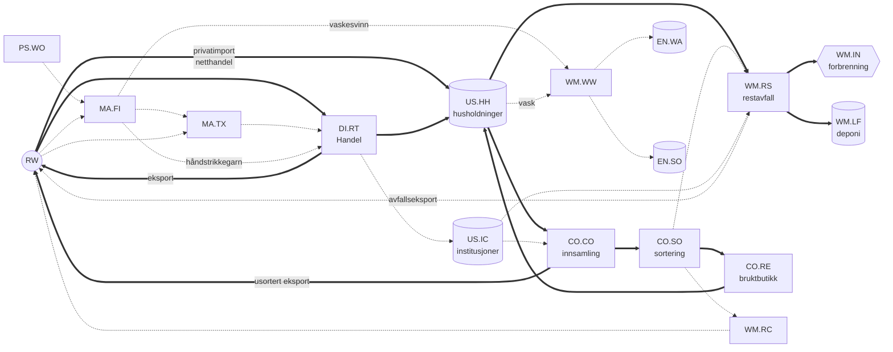

# Systemdefinisjon – Tekstil-MFA for Norge

*Levende dokument. Maskinlesbar kilde: [system/processes.csv](../system/processes.csv) og [system/flows.csv](../system/flows.csv). Endres systemet, oppdateres CSV-filene først, og så denne teksten.*

## Avgrensning

| Dimensjon | Valg (forslag) | Status |
|---|---|---|
| Geografi | Norge (fastlandet). Import og eksport går via poolen RW. | forslag |
| Tid | Data 1988–2025 (SSB 08801 starter i 1988). Rapportering fra 1990 til siste år med handelsdata (nå 2025), slik at lagermodellen får innsvingingsår. | besluttet D2 |
| Produkter | Klær (CL), hjemmetekstiler (HT, inkludert dyner, puter og møbelputer i HS 9404), sko (FW) og andre tekstilvarer (OT). OT er delt i tepper (CA, HS 57), sekker og storsekker (SA, 6305), presenninger, telt og soveposer (TA, 6306 og 9404.30) og andre konfeksjonerte varer (OM, 6307–6308), fordi brukerne og levetidene er svært ulike. CL+HT+FW tilsvarer avgrensningen til NORSUS (2023) og EUs produsentansvar, og kan alltid rapporteres separat (`CORE_PRODUCTS` i `calculations/utils.py`). Garn i detaljsalg (YA) er et eget produkt (D21). Tekniske tekstiler i HS 56 og 59 er utenfor, også som innsatsvarer til MA (D22). | besluttet D1, D21, D22 |
| Enhet | kt produktmasse (nettovekt slik den er deklarert). Tekstilmasse beregnes med andeler for ikke-tekstile deler. | besluttet D4 |
| Materiallag | Fase 1–2: TOT (all masse). Fase 3: fem fibergrupper (SYN, CO, WO, CV, OTH) fra hovedfiberen i HS-kodene og en sammensetningsmatrise. | besluttet D4, D19 (delvis) |

## Navnekonvensjon (arvet fra NitrogenBudsjett)

`KILDE.SUB-MÅL.SUB-Navn-Lag`, for eksempel `RW.RW-DI.RT-Finished textile products import-TOT`.

* Pool = to bokstaver, subpool = to bokstaver.
* Laget er materialet. I N-budsjettet var dette N-forbindelsen (Nmix, NH3, …). Her er alle flytkoder `TOT`. Fiberlaget (D19) er en egen dimensjon `m` i et parallelt system med de samme flytkodene, ikke egne flytkoder.
* Kolonnen `form` i `flows.csv` angir tekstilformen (D18): FIB fibre og garn, FAB metervare, NEW nye varer, MIX brukte usortert, USE brukte ombrukbare, WRN brukte utslitte, PCW produksjonsavfall, MFR mikrofibre, BYP biprodukt som ikke er tekstil (fett og smuss fra ullvasking, D23).
* **Nytt i forhold til N-budsjettet:** Produkt er en dimensjon og ikke en del av flytnavnet (D5). Modellen er bygget i flodym, og hver flyt har dimensjonene sine i kolonnen `dims` i `flows.csv`:
  * `t`: år (1988–2025).
  * `p`: produkt (CL, HT, FW, CA, SA, TA, OM, YA). Brukes til og med salg og i US.IC.
  * `g`: produktgruppe (CORE, CA, SA, TA, OM). Brukes etter bruk i husholdningene, fordi innsamlings- og plukkanalysestatistikken dekker CL+HT+FW samlet (CORE). Garn i detaljsalg (YA) hører til CORE, fordi hjemmelagde plagg kasseres som klær. Produkter regnes om til grupper med en fast koblingsmatrise.
  * Flyter med bare `t` (avfallsbehandlingen og MA.FI) er ikke delt på produkt og rapporteres som `ALL`.
* Lagre er definert i kolonnen `stock_dims` i `processes.csv`. Sluk (WM.IN, EN.AI) får også et lager, som er den akkumulerte massen som har forlatt kretsløpet. flodym sjekker massebalansen per prosess på dimensjonene alle flytene inn og ut har felles.

## Pools og subpools

| Pool | Subpool | Type | Lager? | Innhold |
|---|---|---|---|---|
| **RW** Rest of the world | RW.RW | systemgrense | – | Import og eksport |
| **PS** Primary production | PS.WO | systemgrense | – | Norsk råull |
| **MA** Manufacturing | MA.FI | prosess | klippelager | Ullvaskeri, spinneri |
| | MA.TX | prosess | klippelager | Veving, strikking, konfeksjon, sko |
| **DI** Distribution | DI.RT | prosess | klippelager | Engros, butikk og netthandel |
| **US** Use | US.HH | prosess | **ja** | Husholdninger, inkludert «dvalende» lager (klær som ikke brukes) |
| | US.IC | prosess | **ja** | Arbeidsklær, uniformer og institusjonstekstiler |
| **CO** Collection and sorting | CO.CO | prosess | – | Separat innsamling |
| | CO.SO | prosess | – | Sortering i Norge |
| | CO.RE | prosess | – | Bruktbutikker |
| **WM** Waste management | WM.RS | prosess | klippelager | Restavfall, grovavfall og blandet næringsavfall |
| | WM.IN | sluk | – | Forbrenning med energiutnyttelse |
| | WM.LF | prosess | **ja** | Deponi (viktig før 2009) |
| | WM.RC | prosess | – | Materialgjenvinning |
| | WM.WW | prosess | midlertidig (D24) | Avløpsrensing (fibre fra vask, vaskevann fra ullvasking) |
| **EN** Environment | EN.WA / EN.SO | prosess | **ja** | Fibre i vann og jord |
| | EN.AI | sluk | – | Fibre til luft og støv |

## Systemdiagram (kjerneflyter P1 med tykk strek)

Den fullstendige flytlisten med prioritet, metode og kandidatdata ligger i [system/flows.csv](../system/flows.csv). Den har 43 flyter: 14 med prioritet 1, 17 med prioritet 2 og 12 med prioritet 3 (restavfall fra husholdningene er delt i brukbart og utslitt, D18, og vaskesvinnet fra ullvasking og norsk spunnet håndstrikkegarn er lagt til, D23 og D21). Flytnavn kan ikke inneholde bindestrek, fordi `-` skiller feltene i koden (sjekkes av `tests/test_system_register.py`).

## Metode per flyt (kolonnen `method`)

* **data**: Flyten er målt direkte (for eksempel handelsstatistikk).
* **parameter**: Flyten er en annen flyt eller et lager multiplisert med en overføringskoeffisient eller rate.
* **stock_model**: Flyten er utstrømmen fra lagermodellen (innstrøm og levetid). Brukes ikke for flyter der det finnes offisiell statistikk (D8). Lagermodellen gir da et parallelt anslag til sammenligning.
* **balance**: Flyten er restleddet i massebalansen til en prosess. Hver prosess har høyst én balanseflyt. En negativ flyt er ikke-fysisk og klippes til 0. Fysiske flyter går foran massebalansen: underskuddet flyttes ikke til andre flyter, men tas opp av et klippelager i prosessen (MA.FI, DI.RT og WM.RS, `has_stock = clipping`), som rapporteres som «Clipping imbalance». Hvor ofte og hvor mye det klippes, står på md-siden for flyten. Klipping betyr at dataene ikke er helt konsistente, og er et diskusjonspunkt.

## Beslutninger

| ID | Spørsmål | Anbefaling |
|---|---|---|
| D1 | Produktavgrensning | **Besluttet 2026-09-29:** CL, HT, FW og OT, med OT delt i CA, SA, TA og OM. Alle produktgrupper beregnes separat. Ferdige tekniske varer i HS 56/59 (tau, nett, slanger) er utenfor. Sekker (SA) behandles som emballasje: de kasseres samme år, uten lager i bruk. |
| D13 | Sekker som emballasje | **Besluttet 2026-09-29:** SA går DI.RT → US.IC med levetiden `immediate` (ingen lager) → avfall samme år. Sekker telles med i tilført masse, men holdes utenfor sammenligninger med tekstilavfallsstatistikk, fordi de trolig registreres som plastemballasje der. |
| D14 | Næringslivets varelinjer under 1 000 kr (SSB 99.60.1000) | **Besluttet 2026-09-29:** Holdes utenfor hovedresultatet. Mulig underdekning av klesimport (ca. 7 kt, ≈ 13 % i 2024, svært usikkert) omtales som diskusjonspunkt. Parameter `lowvalue_undercoverage_CL` brukes bare i følsomhetsanalyse. |
| D15 | Kildekjede for tekstiler i restavfall og behandlingsmåte | **Besluttet 2026-09-29:** 1990–1998: SSBs avfallsregnskap for tekstiler (ankerår 1991 og 1998). 1995–2011: SSB 05281, brukt for fordelingen på behandlingsmåter (nivået brukes bare som sammenligning, fordi det kan være beregnet ut fra tilførsel og levetid). 2012–2017: interpolert. 2018, 2022, 2025: plukkanalyser (Mepex) via Watson 2020 og NORSUS 2023/2026. *Nivået før 2009 er endret ved D28.* Se `claude_tekst/2026-09-29_datainventar_P1-flyter.md`. |
| D16 | Metode for grensehandel (privatimport) | **Besluttet 2026-09-29:** 2023–2025: SSB 14221 (klær og sko, NOK) ÷ utsalgspris per kg (NOK/kg fra 08801 × påslagsfaktor). 2004–2022: SSB 05678 i alt × klesandel (snitt 2023–2025). Før 2004: holdes på 2004-nivå. Klær kjøpt på reiser med overnatting er et diskusjonspunkt. |
| D17 | Metode for innsamling før 2018 | **Besluttet 2026-09-29:** Innsamlet = eksport av HS 6309+6310 fra 08801 ÷ eksportandel. Eksportandelen er tidsavhengig, med ankerpunkter fra Watson 2020, NORSUS 2023 og NORSUS 2026 (og 1998 fra SSBs tekstilregnskap hvis tabellene finnes). |
| D18 | Tekstilform | **Besluttet 2026-10-05:** Tekstilform er en egenskap ved flyten (kolonnen `form`), ikke en dimensjon. Åtte koder: FIB, FAB, NEW (inkl. usolgte varer), MIX, USE, WRN, PCW, MFR. Skadede, men reparerbare tekstiler følger sorteringen: sortert til ombruk = USE, ellers WRN. Blandede flyter deles bare der tallet har egen interesse. Foreløpig gjelder det tekstiler i restavfall fra husholdningene (brukbart / utslitt). |
| D19 | Fiberlag | **Besluttet 2026-10-05:** Fem fibergrupper: syntetisk (SYN: PES, PA, PAC, PP, EL), bomull (CO), ull (WO), regenerert cellulose (CV) og annet (OTH), pluss ikke-tekstil (NT, erstatter regnestykket med `nontextile_share_*`). Gruppene er valgt fordi HS-kodene sjelden skiller mellom polymerene. Syntetisk deles i polymerer bare i flyter der polymeren betyr noe (mikrofibre, materialgjenvinning). Fiber er en dimensjon `m` i et parallelt flodym-system, beregnet etter TOT. Sammensetningen av kasseringer fra husholdningene kommer fra årgangsmodellen. Se METODE § 9. |
| D20 | Tidskonvensjon for flyter og lager | **Besluttet 2026-10-05:** Flyter er summer per kalenderår, slik de fleste datakildene oppgir dem. Lager er nivået ved årsslutt. I lagermodellen regnes innstrømmen som om den kom midt i året, som et gjennomsnitt for et kalenderår. En årgang er da 0,5 år gammel ved første årsslutt. Dette er standard i flodym (`inflow_at='middle'`). For levetider under ca. ett år kan innstrømmen spres jevnt over året (`n_pts_per_interval`). |
| D2 | Tidsperiode og startlager | **Besluttet 2026-09-29:** Rapporter fra 1990 til siste år med data (2024 da beslutningen ble tatt, 2025 fra oppdateringen samme dag). Innstrøm før 1988 settes til 1988-nivået (alternativt en trend), og startlageret testes i en følsomhetsanalyse. |
| D3 | Hvor detaljert skal MA være? | **Besluttet 2026-09-29:** Enkel balanse (P2). Norsk tekstilindustri er liten, men ull er en norsk særegenhet. |
| D4 | Masse og lag | **Besluttet 2026-09-29:** Produktmasse er primær. Tekstilmasse beregnes via `nontextile_share_*`. Fiberlaget kommer i fase 3. |
| D5 | Produktdimensjon | **Besluttet 2026-09-29:** Kolonnen `product` i resultatene (er implementert). |
| D6 | Eksport: gjeneksport eller norsk produksjon? | **Besluttet 2026-09-29:** All eksport av ferdigvarer føres fra DI.RT (6,6 kt i 2022, mot 148 kt import). Når MA er kvantifisert, flyttes en andel til MA.TX → RW, begrenset oppad av norsk produksjon. |
| D7 | Privatimport og direkte netthandel | **Besluttet 2026-09-29:** Kronebeløp fra grensehandelsstatistikk og forbruksundersøkelser regnes om til kg med NOK/kg per varegruppe fra 08801. Direkte netthandel får stor usikkerhet, og VOEC-året 2020 legges inn som et brudd i tidsserien. Første steg er å avklare hvordan lavverdiforsendelser føres i 08801 før og etter 2020. |
| D8 | Massebalansestrategi | **Besluttet 2026-09-29:** Offisiell avfallsstatistikk er hovedkilden for kasseringer (innsamling, restavfall, deponi og forbrenning). Lagerendringen i US.HH og US.IC blir restleddet: tilført minus kassert. Lagermodellen (innstrøm og levetid) kjøres parallelt og brukes til sammenligning og diskusjon, ikke til å fylle hull. Hull i avfallsdataene interpoleres mellom offisielle ankerpunkter. |
| D9 | Uformell ombruk (Finn, Tise, arv) | **Besluttet 2026-09-29:** Regnes som lengre levetid i US.HH, ikke som egen flyt. Det påvirker bare den parallelle lagermodellen, fordi hovedresultatet har lagerendringen som restledd (D8). |
| D10 | Dvalende lager | **Besluttet 2026-09-29:** Ligger inne i US.HH. Levetiden måles fra kjøp til kassering, inkludert lagringstid. Andelen som ikke brukes kan eventuelt skilles ut som diskusjonspunkt hvis garderobestudiene oppgir den. |
| D11 | Forbrenning | **Besluttet 2026-09-29:** WM.IN er et sluk (aske og utslipp følges ikke). Forbrenning i utlandet er en flyt til RW, beregnet som eksportert restavfall × tekstilandel fra plukkanalyser. |
| D12 | Framtidsscenarier (produsentansvar, 2030+) | **Besluttet 2026-09-29:** Utenfor omfanget til den historiske modellen er ferdig. Arkitekturen skal likevel tillate det. |
| D21 | Garn i detaljsalg | **Besluttet 2026-10-12:** Garn i detaljopplegg (HS 5109, 5207, 5204.20, 5406, 5511) er et eget produkt YA. Det går RW → DI.RT → US.HH og ikke til MA.FI, fordi det strikkes eller sys til plagg i husholdningene. YA hører til produktgruppen CORE etter bruk. Levetiden i lagermodellen (8 år, garnlager pluss plaggets levetid) er en antakelse. Norsk spunnet håndstrikkegarn går MA.FI → DI.RT (SSB Industristatistikk, Varetall 1988–89: 0,99 og 0,89 kt; SSB 10455, Prodcom 13.10.50.50: 0,59–1,03 kt i 2008–2023; interpolert i 1990–2007). Ut av DI.RT blandes det med importert detaljgarn i fiberlaget. |
| D22 | HS 56 og garn til tau og nett | **Besluttet 2026-10-12:** HS 56 (vatt, filt, fiberduk, tau, nett) er utenfor omfanget, også som innsatsvare til MA. Høyfast filamentgarn av nylon, polyester og aramid (5402.10, 5402.11, 5402.19, 5402.20; import 1,3–5,6 kt per år) er garnet tau og nett lages av, og er også utenfor, både for import og eksport. Det samme gjelder tvunnet nylongarn (5402.61, nettgarn), annet enkelt syntetisk filamentgarn (5402.49) og polypropylen stapelfiber (5503.40, fiberduk), til sammen 0,6–2 kt per år (besluttet 2026-10-12). Importen er stor (tau 13,7 kt, nett 10,0 kt og fiberduk 12,2 kt i 2022), men går til fiske, havbruk, bygg og hygieneprodukter. Fiber og garn (FY) og metervare (FA) skilles i `parameters/hs_mapping.csv`. |
| D23 | Vaskesvinn ved ullvasking | **Besluttet 2026-10-12:** Egen flyt MA.FI → WM.WW (form BYP): uvasket ull vasket i Norge × svinnandel (ca. 1/3). Uvasket ull vasket i Norge er norsk ull + import − eksport av uvasket ull, som periodesnitt fordi årsbalansen er preget av lagring og tidspunkt (negativ i 2017). Usikkerheten er standardfeilen til snittet. Eksport deklarert som karbonisert ull (5101.30) i 1996–2000 og 2002 regnes som uvasket, fordi prisen per kg er som for uvasket ull og eksporten av uvasket ull faller like mye de årene. Fra 2007 eksporteres 90–100 % av norsk ull uvasket, og det meste vaskes i Bradford. I fiberlaget regnes uvasket ull som ull, inkludert fettet. |
| D24 | Midlertidige lagre | **Besluttet 2026-10-12:** MA.TX og WM.WW har et midlertidig lager (`stock_dims` = t) til utstrømmene deres er implementert, slik at systemet lukker og massebalansen sjekkes. Lagerendringen er da lik innstrømmen og er ikke et lager i fysisk forstand. Lagrene fjernes når MA.TX- og WM.WW-flytene er på plass. |
| D25 | MA.TX: metervare, eksport og produksjonsavfall | **Besluttet 2026-10-12:** Import og eksport av metervare (vevnader i HS 50–55, HS 58 og 60) fra 08801. MA.TX → RW er bare metervare, og eksporten av ferdigvarer blir værende i DI.RT (D6). Produksjonsavfall fra SSBs industriavfallsundersøkelse (NACE 13–15: 1 kt i 2008, under 0,5 kt i 2015 og 2022), uttrykt per kt innsatsvare (garn og metervare) i ankerårene, slik at avfallet følger innsatsen før 2008 med 2008 som referanse. Ferdigvarer til DI.RT og fordelingen på produkter er ikke besluttet ennå. Til da tar det midlertidige lageret i MA.TX opp balansen (D24). |
| D26 | MA.TX → DI.RT og dyner | **Besluttet 2026-10-12, implementert 2026-10-13:** Ferdigvarer fra MA.TX til DI.RT er balansen i MA.TX, fordelt på produkter med masseandeler fra SSBs varestatistikk i ankerår: 1988–89 (Industristatistikk, Varetall) og 2008, 2009, 2011 (Prodcom). Mengde i kg brukes direkte, stykk ganges med kg per stykk fra importen av samme HS-kode, og koder med bare verdi deles på norsk pris per kg fra år der både mengde og verdi finnes. Prodcom-årene er for tynne hver for seg, så snittet per varekode for 2008, 2009 og 2011 er ett ankerpunkt (2009). Andelene interpoleres mellom 1988, 1989 og 2009 og holdes fast etter 2009. Sko holdes utenfor, fordi lær og gummi ikke er innsatsvarer i MA.TX. Dyner, hodeputer og møbelputer (9404.40 og 9404.90) er hjemmetekstiler (HT), og soveposer (9404.30) er TA (besluttet 2026-10-13). Møbelputer er for det meste skum og regnes som ikke-tekstil (NT) i fiberlaget. MA.TX har nå et klippelager i stedet for det midlertidige lageret (D24). |
| D27 | DI.RT: usolgte varer, institusjoner, gjeneksport | **Besluttet 2026-10-13:** Usolgte klær gitt til innsamlere (Watson 2020: ca. 600 t i 2018; Rubach 2023: ca. 200 t i 2022) og kastet (minimum fra undersøkelsene: 95 t i 2018 og 221 t i 2022) er egne flyter. Begge uttrykkes per kt klesimport i ankerårene, så de følger klesimporten før, mellom og etter. Donerte varer eksporteres med de brukte tekstilene og trekkes fra innsamlingen fra husholdningene. EEAs anslag (4–9 % av det som settes på markedet destrueres) brukes bare til følsomhetsanalyse og diskusjon. Andelen til institusjoner og bedrifter (12 %), gjeneksport (D6) og små varelinjer (D14) beholdes. |
| D28 | US.HH: restavfall før 2009, netthandel, andre varer, fiberutslipp | **Besluttet 2026-10-13:** (1) Før 2009 holdes restavfallet (CORE) fast per innbygger på 2009-nivået (Laitala m.fl. 2012). SSBs tekstilregnskap for 1998 brukes ikke som nivå, fordi det trolig er beregnet ut fra tilførselen. Dette erstatter delen av D15 som gjelder nivået for 1990–2008. (2) Direkte netthandel er 0 i 2019 og følger VOEC for 2023–2025. Watsons 2018-anslag og VOEC 2022 brukes ikke (A2). (3) Tepper, presenninger og andre konfeksjonerte varer kasseres med årgangsmodellen og levetidene i `lifetimes.csv`, som et unntak fra D8. (4) Fiberutslipp ved vask: 600 t syntetisk i 2014 (Mepex for Miljødirektoratet), skalert med tekstillageret i årgangsmodellen. Naturfibre har samme utslipp per kt og skilles fra syntetisk i fiberlaget. (5) Fiberutslipp til luft og støv er på samme nivå som ved vask (faktor 1, 0,3–3). (6) Påslaget for grensehandel (2,5) beholdes. |
| D29 | US.IC: lagermodell | **Besluttet 2026-10-13:** Kasseringer fra institusjoner og bedrifter beregnes med årgangsmodellen (`calculations/cohorts.py`) og levetider per varetype i `parameters/lifetimes.csv`, fordi det ikke finnes kasseringsstatistikk for sektoren (unntak fra D8). Sekker kastes samme år (D13). Erstatter antakelsen om stasjonær tilstand. Fiberutslipp fra industrivask har samme utslipp per kt tekstil som husholdningsvask, brukt på tekstillageret i US.IC. Innsamling fra institusjoner står som planlagt (ingen data). |
| D30 | Usikkerhet for interpolerte og ekstrapolerte år | **Besluttet 2026-10-13:** År uten publiserte tall får en ekstra lognormal faktor (median 1) med variasjonskoeffisient 2 % per år til nærmeste punkt inne i et gap og 5 % per år utenfor, tak 100 %, ett trekk per gap og iterasjon, begrenset til ±2 standardavvik. Se METODE § 5. CO.CO har fått klippelager, fordi innsamlingen fra husholdningene (balansen i CO.CO) kan bli negativ når donerte usolgte varer trekkes høyt tidlig i perioden. |
| D31 | CO.CO: innsamling | **Besluttet 2026-10-14:** Eksporten av brukte tekstiler (08801, 6309+6310) er hovedserien for innsamlingen, fordi den er mer fullstendig enn kartleggingene: NORSUS oppgir selv eksport fra tollstatistikken som er større enn rapportert innsamling. Andelen som sorteres i Norge, holdes på 2018-nivået før 2018 (med D30-usikkerhet). Filler (6310) beholdes i eksporten fra innsamlingen. KOSTRA (SSB 13035, tekstiler til ombruk) er en nedre kontroll. |
| D32 | CO.SO: import, eksport av sortert, gjenvinning | **Besluttet 2026-10-14:** Import av brukte tekstiler (08801) er implementert: brukte klær (6309) går til bruktbutikk, filler (6310, mest tørkefiller) til sorteringsrester og restavfall. 6310 er skilt ut som eget produkt (RG) i HS-mappingen. Eksport av sortert står som planlagt (filler er med i eksporten fra CO.CO). Sortert til materialgjenvinning implementeres med WM.RC, med 93 t i 2018 (Watson 2020) og 142 t fra husholdninger i 2025 (de Sadeleer & Rubach 2026). |
